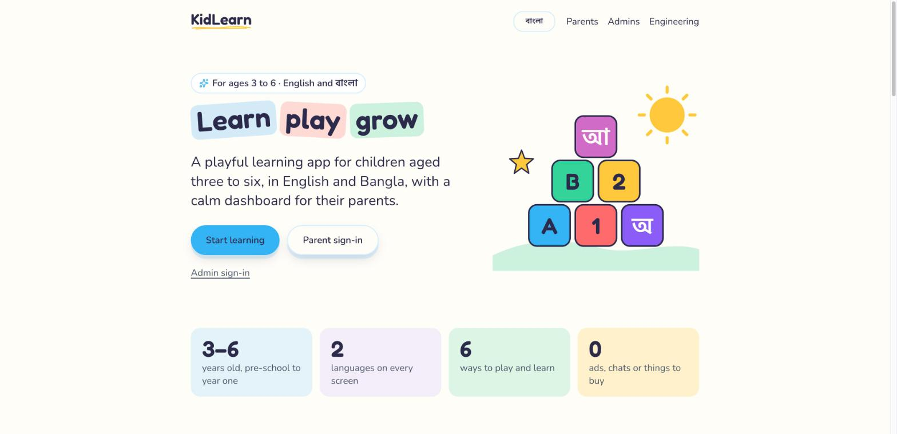
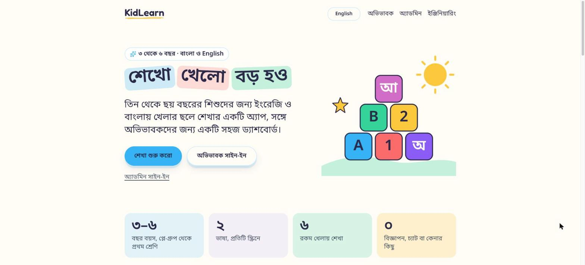
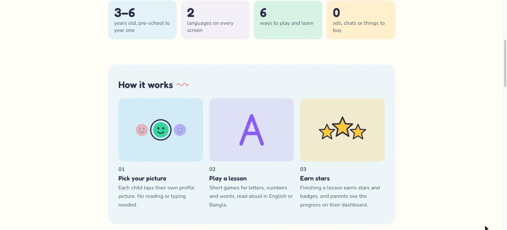
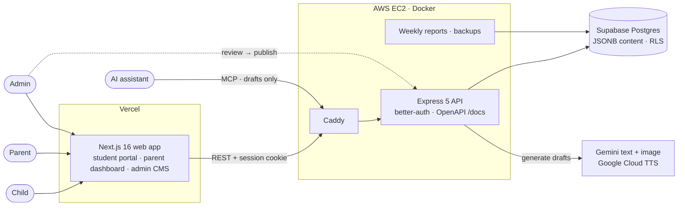

# KidLearn

[](https://github.com/salmanbd100/kidlearn/actions/workflows/ci.yml)
[](LICENSE)


> A bilingual (English/Bangla) learning platform for children aged 3–6, with a parent dashboard, an admin CMS and an AI content pipeline that never publishes without human review. I built it for my two daughters.

**[kidlearn.net](https://kidlearn.net)** · [API reference](https://api.dev.kidlearn.net/docs) · [Engineering guide](https://kidlearn.net/guide/engineering)

<p align="center">
  
  
  
</p>

## Live

| Environment | Website | API | Deploys from |
|---|---|---|---|
| **Production** | <https://kidlearn.net> | <https://api.kidlearn.net> | `main` |
| **Dev** | <https://dev.kidlearn.net> | <https://api.dev.kidlearn.net> · [API reference](https://api.dev.kidlearn.net/docs) | `dev` |

Dev runs unreviewed builds against its own database and is not listed by search engines. The API reference is served on dev only.

---

## Engineering highlights

- **One schema, three uses.** Every request and response is a Zod schema in [`packages/types`](packages/types/src/api/). The API validates with it, the web app types against it, and the OpenAPI document at `/docs` is generated from it, so there is no hand-written spec to drift.
- **The docs can't fall behind the code.** [`coverage.test.ts`](apps/server/src/openapi/coverage.test.ts) walks the live Express routers and fails the build if any route is undocumented. Every successful response in a route test passes through [`assertContract`](apps/server/src/openapi/assert-contract.ts) against its published schema.
- **The server owns progress.** Stars, streaks, learning time and lesson completion are computed server-side. The server enforces lesson step order, needs evidence before it pays a completion, rate-limits client events and [refuses writes without current parental consent](apps/server/src/shared/middleware/require-consent.ts).
- **Content is data, not code.** Activities and quizzes are versioned JSONB payloads ([`activity`](packages/types/src/activity/), [`quiz`](packages/types/src/quiz/)) rendered by generic engines. A new lesson needs no deploy.
- **AI output is drafted, never published.** Gemini generates lessons, stories, quizzes, narration and illustrations into a review queue. An [MCP server](apps/server/src/modules/mcp/) lets AI assistants author drafts too, scoped so they cannot publish. Only an admin moves content to `published`.
- **Child safety is enforced by tests.** The student portal has no ads, no external links and no social features. [`no-external-links.test.tsx`](<apps/web/app/(student)/no-external-links.test.tsx>) fails if any student screen links off-site. Postgres [row-level security](packages/db/prisma/migrations/20261010120000_enable_row_level_security/migration.sql) is [tested against a real database](apps/server/src/shared/testing/row-level-security.db.test.ts).
- **One gate for every change.** A single CI job runs lint, build, typecheck, 240+ test files with coverage, the real-Postgres suites and three Docker builds. It is a required check on `main` and `dev`, which only accept pull requests.

## Architecture



---

## The Story Behind It

I am a developer and a father. The best educational apps I found for my daughters were too expensive, not available in Bangla, or not built around how young children actually learn. So I built one.

**KidLearn** ("Learning Adventure") is a safe, gamified, voice-guided web platform for early learners (Nursery, KG-1, KG-2). Lessons are short and cover Language, Mathematics, Science and Social Skills, with animated characters, interactive activities, stories and quizzes, in a focused 30-to-60-minute daily session.

---

## What It Does

| Pillar | Description |
|---|---|
| **Visual-first, voice-guided** | Children who cannot yet read can navigate and learn independently — every instruction is spoken aloud |
| **Chunked learning flow** | Each lesson follows the same five-step structure: Introduction → Video → Activity → Quiz → Reward, so children always know what comes next |
| **Dual portal** | A distraction-free **Student Portal** (no ads, no external links, no social features) and a **Parent Dashboard** for progress and weekly reports, with an **Admin CMS** behind them and a public **homepage and guides** in front |
| **AI content pipeline** | Lessons, stories, quizzes, narration audio, and illustrations are AI-generated at scale — but every piece goes through a mandatory human admin review before any child sees it |
| **Multilingual from day one** | English and Bangla at launch; the i18n architecture is data-driven, so Arabic, Hindi, and Spanish roll out as asset sets, not code changes |
| **Gamification** | Stars, coins, badges, character unlocks, and daily learning streaks — all earned through learning, never purchased |

---

## Tech Stack

| Layer | Technology |
|---|---|
| Monorepo | Turborepo + pnpm workspaces |
| Frontend | Next.js 16 (App Router), React 19, Tailwind CSS v4 |
| Backend | Express 5 + TypeScript (ESM) |
| Database | PostgreSQL — Supabase in deployment, a local Docker container for development. Relational data + `JSONB` for quiz/activity schemas |
| ORM | Prisma (`packages/db`) |
| API docs | OpenAPI 3.0 generated from Zod schemas → Scalar API reference at [`/docs`](https://api.dev.kidlearn.net/docs) |
| Validation | Zod — one schema per contract, shared between the API and the web app (`packages/types`) |
| Testing | Vitest — Supertest for API routes, React Testing Library for components |
| i18n | i18next on frontend + per-language asset refs in DB |
| AI — text & quizzes | Gemini text models (free tier) → typed JSON payloads validated against shared schemas |
| AI — audio | Google Cloud Text-to-Speech (Standard voices, one per language) |
| AI — images | Gemini image models (free tier) |
| AI — video | Made outside the app in Google Veo or Runway Gen-3 from the generated narration script, then uploaded through the CMS |
| AI — authoring | MCP server — AI assistants create drafts that go through the same review queue |
| Auth | better-auth — Google sign-in for parents, password for seeded admins |
| Linting & formatting | Biome (repo-wide, replaces ESLint + Prettier) |
| Hosting | Vercel (web) + one AWS EC2 box running the API in Docker behind Caddy |

### Repo layout

```
kidlearn/
├── apps/
│   ├── web/        # Next.js — public homepage + guides, student portal, parent dashboard, admin CMS
│   └── server/     # Express API — progress, quiz responses, AI pipeline
│       └── src/openapi/   # OpenAPI document served at /docs
├── packages/
│   ├── ui/         # Theme-agnostic React primitives — web-only by design (mobile-app-plan.md §4.2)
│   ├── types/      # Shared Zod schemas — activity/quiz payloads + API contracts (src/api/)
│   ├── db/         # Prisma schema + client (PostgreSQL)
│   ├── i18n/       # en/bn UI strings — one copy for web and mobile
│   ├── tokens/     # Design-token values — tokens.css is generated from them
│   └── config/     # Shared TS configs
├── deploy/         # Production scripts (deploy, bootstrap, backup, weekly reports) + Caddy edge
├── docker/         # Local Postgres init scripts
└── document/       # Requirements, design, standards, implementation specs, deploy guides
```

---

## Running locally

Node 22, pnpm 9 and Docker. In short: `pnpm install`, `docker compose up -d postgres`, copy the two example env files, `pnpm db:migrate`, seed, then `pnpm dev`. That gives you the web app on `:3000`, the API on `:4000` and the API reference on `:4000/docs`.

The exact commands, env values, port conflicts, admin accounts and everything else are in **[CONTRIBUTING.md](CONTRIBUTING.md)**. Deployment is in [`document/deployment/`](document/deployment/README.md) and day-two operations are in [`runbook.md`](document/runbook.md).

---

## How I use AI to build this

The product uses AI to draft content, and I use it to help write code. In both cases a human gate decides what ships. Claude Code works in this repo with project skills I wrote ([`.claude/skills/`](.claude/skills/)), such as spec-driven implementation, code review and dependency upgrades. Its commits are co-authored, so it shows up as a contributor. Every change still goes through a reviewed pull request and the same `gates` CI job, and it works from specs I write ([`document/implementation/`](document/implementation/)).

---

## MVP Scope

The first release targets **ages 3–5** (Nursery + KG-1) in **English and Bangla**:

- Alphabet (A–Z), Numbers (1–20), Shapes, Colors
- 20 starter stories
- All four interactive activity types (drag-drop, trace, match, puzzle)
- All four quiz formats (multiple choice, match-pair, drag-answer, picture selection)
- Parent dashboard with learning time and weekly reports
- AI content pipeline with human review queue

---

## Roadmap

| Phase | Scope |
|---|---|
| **Phase 1 (MVP)** | Ages 3–5, English + Bangla, core curriculum, AI pipeline |
| **Phase 2** | KG-2, Arabic, teacher role + virtual classrooms, Space World subjects |
| **Phase 3** | Hindi + Spanish, Grade 1+, school administration |

---

## Project Docs

Detailed specs live in `document/`:

- [`project-requirement-details.md`](document/project-requirement-details.md) — full functional + non-functional requirements
- [`design.md`](document/design.md) — UI/UX design decisions
- [`database-design.md`](document/database-design.md) — full data model
- [`engineering-standards.md`](document/engineering-standards.md) — coding standards index, routing to:
  - [`standards/general.md`](document/standards/general.md) — applies to every task (layout, TypeScript, imports, naming, testing, GitHub flow)
  - [`standards/frontend.md`](document/standards/frontend.md) — `packages/ui`, `apps/web`, React/Next.js
  - [`standards/backend.md`](document/standards/backend.md) — `apps/server`, Prisma, `packages/db`, API design, and the OpenAPI rules every new endpoint follows (§7)
- [`user-journey-manual.md`](document/user-journey-manual.md) — end-to-end user flows
- [`admin-account-guide.md`](document/admin-account-guide.md) — creating and using an admin account
- [`deployment/`](document/deployment/README.md), [`runbook.md`](document/runbook.md) — deploying and operating production
- [`mobile-app-plan.md`](document/mobile-app-plan.md) — what is shared between web and the planned mobile app
- [`implementation/`](document/implementation/) — one spec per piece of work, tracked in `00-progress-tracker.md`

The running app also carries short, translated guides for parents, admins and engineers at `/guide/parents`, `/guide/admins` and `/guide/engineering`.

---

## Licence

[MIT](LICENSE) © Salman Rahman

*Built with love — for two little girls who deserve the best start.*
