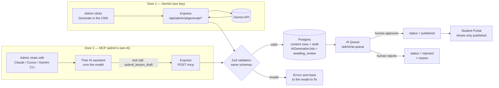
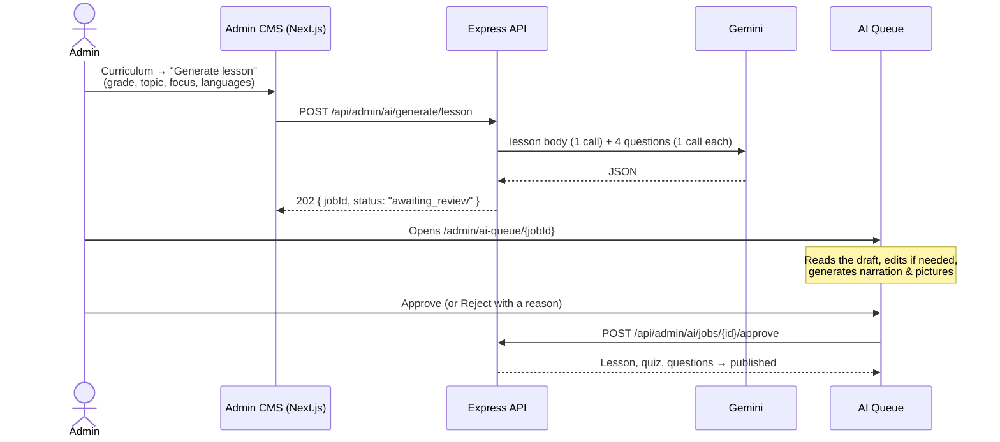
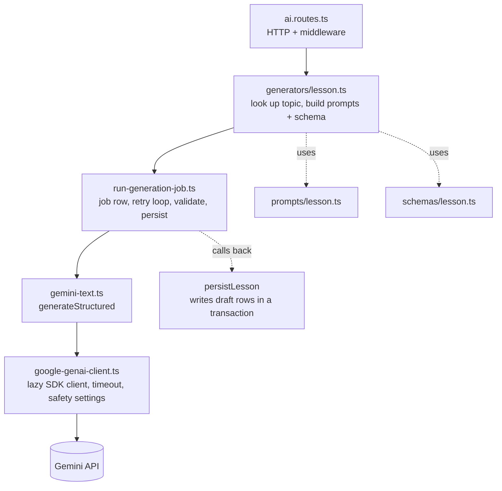
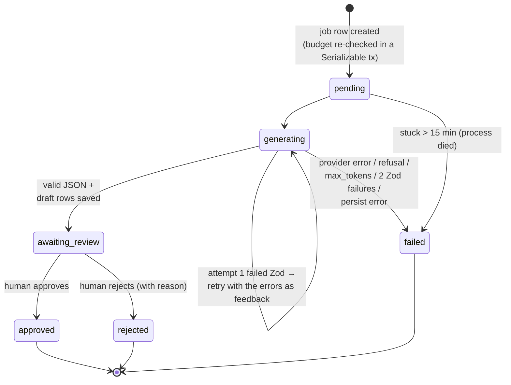
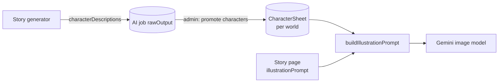
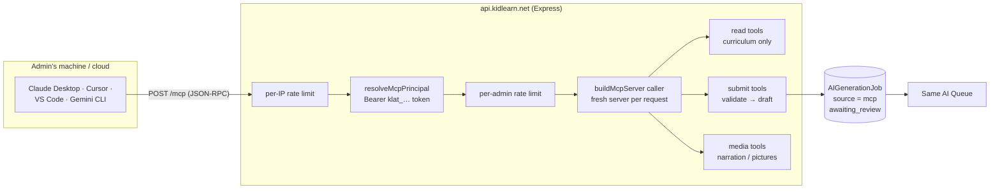
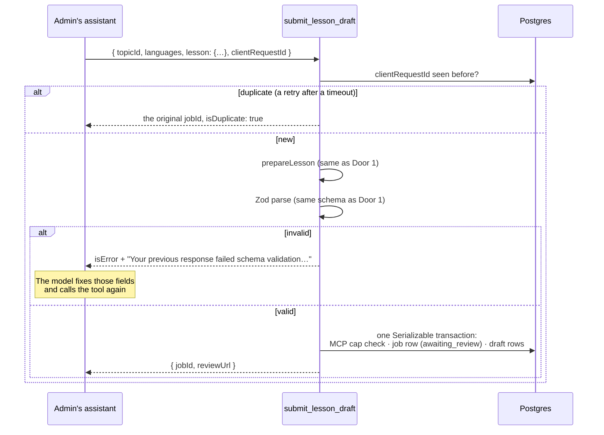
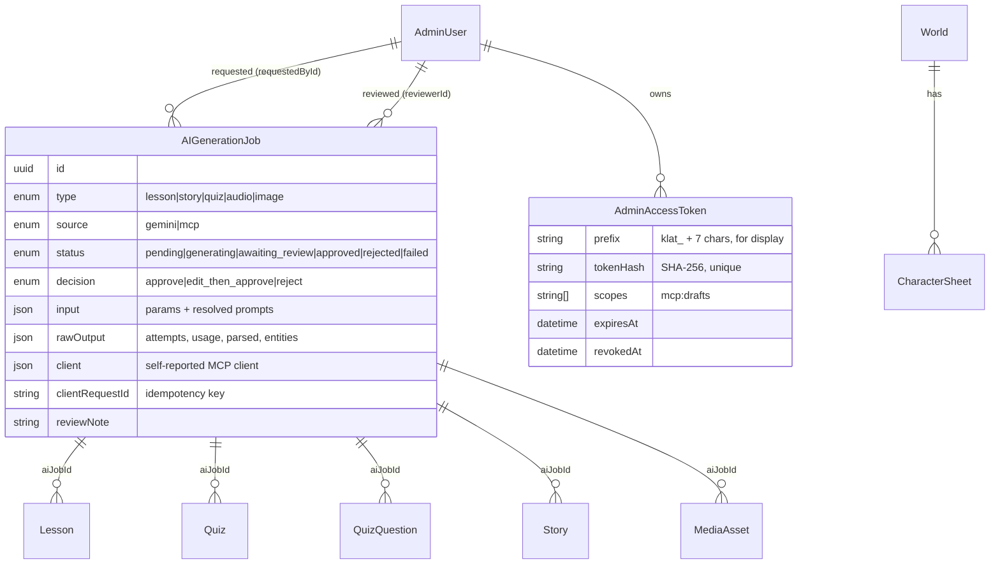

# How AI Works in KidLearn — A Developer's Guide

A beginner-friendly tour of every place AI touches KidLearn: what problem it solves, what the
admin sees, how the code is built, and what we gave up to get there. Read it top to bottom once;
afterwards use the [file map](#13-file-map) and the [glossary](#2-glossary) as a reference.

> **Status.** Describes the code on `dev` as of October 2026, after file 41 (MCP content
> authoring) merged. The specs it summarises are
> [`implementation/41-mcp-content-authoring.md`](./implementation/41-mcp-content-authoring.md)
> and the FR-AI rows in
> [`project-requirement-details.md §5.13`](./project-requirement-details.md#513-ai-content-generation-pipeline-fr-ai).
> If this guide and the code disagree, the code wins — fix the guide.

---

## Contents

1. [The problem AI solves](#1-the-problem-ai-solves)
2. [Glossary](#2-glossary)
3. [The big picture: two doors, one gate](#3-the-big-picture-two-doors-one-gate)
4. [What each user sees](#4-what-each-user-sees)
5. [Door 1 — Gemini generation inside KidLearn](#5-door-1--gemini-generation-inside-kidlearn)
6. [Narration and illustrations](#6-narration-and-illustrations)
7. [Door 2 — Bring your own AI over MCP](#7-door-2--bring-your-own-ai-over-mcp)
8. [The gate — human review](#8-the-gate--human-review)
9. [Cost and abuse controls](#9-cost-and-abuse-controls)
10. [Safety and privacy](#10-safety-and-privacy)
11. [Trade-offs we chose](#11-trade-offs-we-chose)
12. [Data model](#12-data-model)
13. [File map](#13-file-map)
14. [Walkthrough: adding a new kind of generated content](#14-walkthrough-adding-a-new-kind-of-generated-content)
15. [Testing AI code](#15-testing-ai-code)
16. [Configuration](#16-configuration)
17. [Common pitfalls](#17-common-pitfalls)

---

## 1. The problem AI solves

KidLearn teaches children aged 3–6 in English and Bangla. Every lesson needs:

- a child-facing title and a spoken mascot intro, **in every language**;
- a 60–120-word narration script;
- 3–5 quiz questions in four different interactive formats, each a strict JSON payload;
- audio for every spoken line, per language;
- illustrations, with recurring characters that look the same in every picture.

A story needs 6+ pages of text, illustration prompts and a moral — again in both languages.

Writing this by hand is the bottleneck. A small team cannot fill three grade levels across many
subjects. **AI drafts the content; a person decides whether it reaches a child.** That second
half matters more than the first: the audience is pre-readers, so a single scary sentence or a bad
translation is a real harm, not a typo.

So the AI integration has to solve four problems at once:

| Problem | How KidLearn answers it |
| --- | --- |
| **Volume** — too much content to write by hand | Generators draft whole lessons, stories and quizzes in one click (or one chat) |
| **Shape** — content is JSON a game engine renders, not prose | Every model answer is validated against the same Zod schemas the app uses, and retried with the errors when it fails |
| **Safety** — the audience is 3–6 | Strict prompt rules, strictest provider safety filters, and a **mandatory human review gate** (FR-AI-07) |
| **Cost** — model calls cost money and quota | Daily budgets per cost bucket, and an option to use the admin's own AI subscription instead of ours |

---

## 2. Glossary

If you have not worked with LLMs before, these are the words this guide uses.

| Term | Meaning here |
| --- | --- |
| **LLM** | Large language model — Gemini, Claude, GPT. Takes text in, returns text out. |
| **Prompt** | The text we send. A **system prompt** sets the rules ("you write for 3–6 year olds"); a **user prompt** is the specific request ("a lesson on counting to five"). |
| **Structured output** | Asking the model to answer with JSON matching a JSON Schema, instead of free text. |
| **Token** | The unit models bill by — roughly ¾ of an English word. Input and output tokens are counted separately. |
| **Refusal / safety block** | The provider declines to answer because the prompt or answer tripped a safety filter. |
| **TTS** | Text-to-speech. We use Google Cloud TTS to turn scripts into MP3 narration. |
| **MCP** | Model Context Protocol — an open standard that lets an AI assistant (Claude Desktop, Cursor, Gemini CLI…) call **tools** on a remote server. KidLearn is an MCP server. |
| **AI job** | One row in `AIGenerationJob`: a record of one generation — what was asked, what came back, and what a reviewer decided. |
| **Draft** | Content with `status: draft`. Children never see it; only `published` content is served to the Student Portal. |

---

## 3. The big picture: two doors, one gate

There are two ways AI-written content enters KidLearn, and exactly one way out.



Three ideas carry the whole design:

1. **The model is the only provider-specific piece.** Looking up the topic, building the schema,
   validating, saving rows, and reviewing are shared by both doors. Door 2 replaces only "who
   writes the JSON".
2. **AI never publishes.** Every generator writes `draft` rows. Only a human pressing *Approve*
   moves them to `published`, and a database-level check refuses to publish AI content without an
   approved job — even if someone tries through the ordinary CMS.
3. **Every generation leaves an audit trail.** The `AIGenerationJob` row keeps the inputs, the
   resolved prompts, every raw attempt, token usage, who asked, which tool wrote it, and who
   approved it (FR-AI-08).

---

## 4. What each user sees

### Children and parents

Nothing that says "AI". The Student Portal and Parent Dashboard read only `published` content.
AI is a **back-office** tool. This is deliberate: no child or parent data is ever sent to an AI
provider (see [§10](#10-safety-and-privacy)).

### Admins — Door 1 (Gemini)



Screens involved:

| Screen | Route | What it does |
| --- | --- | --- |
| Generate lesson dialog | `/admin/curriculum` → `GenerateLessonDialog.tsx` | Starts a lesson job |
| Generate quiz button | `/admin/curriculum` → `GenerateQuizButton.tsx` | Starts a quiz job for an existing lesson |
| Generate story dialog | `/admin/stories` → `GenerateStoryDialog.tsx` | Starts a story job |
| Story media panel | `/admin/stories` → `StoryMediaPanel.tsx` | Narration and illustrations per page |
| AI Queue | `/admin/ai-queue` | Every job awaiting review, with a badge count in the sidebar |
| Job detail | `/admin/ai-queue/[id]` | Raw output, linked content, blockers, approve / reject |

### Admins — Door 2 (their own AI assistant)

1. Open **AI assistants** (`/admin/ai-assistants`) and create an **access token** (`klat_…`).
2. Paste the token and the MCP URL into Claude Desktop, Cursor, VS Code, Gemini CLI, etc.
   The page shows a ready-made config snippet per client (`_components/client-setup.ts`).
3. Chat: *"Write a KG-1 lesson on counting to five, in English and Bangla."* The assistant
   calls `list_curriculum`, writes the lesson, and calls `submit_lesson_draft`.
4. The draft appears in the same AI Queue, labelled *"Written by Claude Desktop 1.4
   (self-reported) via MCP"*, followed by the requesting admin's name.

When Gemini is not configured on the server, every *Generate* button turns into *"Write with
your AI assistant"* — see `GeminiOrAssistantAction.tsx`:

```tsx
// apps/web/features/admin/ai/GeminiOrAssistantAction.tsx
export function GeminiOrAssistantAction({ capabilities, capability = "geminiText", children }) {
  if (capabilities?.[capability] !== false) return <>{children}</>; // Gemini on (or still loading)
  if (!capabilities.mcp.enabled) return null;                       // neither door open

  return (
    <Button asChild variant="outline">
      <Link href={ADMIN_ROUTES.aiAssistants}>Write with your AI assistant</Link>
    </Button>
  );
}
```

The web app learns what is available from `GET /api/admin/ai/capabilities`
(`capabilities.ts`) — it never guesses from environment variables of its own.

For the step-by-step admin workflow (prompts to paste, NotebookLM for research, review tips),
read [`content-authoring-playbook.md`](./content-authoring-playbook.md).

---

## 5. Door 1 — Gemini generation inside KidLearn

### 5.1 Request pipeline

Every generate route is a chain of small Express middlewares, each with one job:

```ts
// apps/server/src/modules/admin/ai/ai.routes.ts
adminAiRouter.post(
  "/generate/lesson",
  requireGemini,                      // 503 if GEMINI_API_KEY is unset
  requireGenerationBudget("lesson"),  // 429 if today's "text" budget is spent
  validate({ body: GenerateLessonSchema }),
  async (req, res, next) => {
    try {
      const result = await generateLesson(req.body, {
        requestedById: adminContext(req).id,   // who asked — for the audit trail
      });
      res.status(202).json({ data: result });  // 202: a job, not finished content
    } catch (error) {
      next(error);
    }
  },
);
```

The whole router sits behind `requireAdmin` (mounted from `admin.routes.ts`), so only a signed-in
admin reaches it. The order matters: `requireGemini` runs before the budget check so an admin on a
server with no key gets "use MCP instead", not "wait until tomorrow".

### 5.2 The layers



Each generator (`lesson`, `story`, `quiz`) follows the same recipe: a **prepare** step (database
lookups, no model call), a **generate** callback, a **schema**, and a **persist** callback. That
split is what lets Door 2 reuse everything except the model call.

### 5.3 Prompts: the rules the model must follow

One system prompt is shared by every text generator — and, as we will see, by Door 2 too:

```ts
// apps/server/src/modules/admin/ai/prompts/lesson.ts (abridged)
export const KIDLEARN_SYSTEM_PROMPT = `You are a curriculum writer for KidLearn, an educational platform for children aged 3 to 6
(grades: Nursery, KG-1, KG-2). You write warm, simple, encouraging content designed to be
READ ALOUD to a child who cannot yet read.

Hard rules:
- Age-appropriate: short sentences, concrete everyday words, playful and gentle tone.
- Culturally neutral: no religious references, no country-specific idioms, no brand names, …
- Safe: absolutely no violence, fear, scary imagery, danger, injury, or negative pressure.
- Multilingual: every child-facing string must be provided in EVERY requested language with
  natural, native-quality phrasing — never a literal word-for-word translation.
- Output ONLY by calling the provided tool with JSON conforming exactly to its schema.`;
```

The user prompt is built per request from the admin's form (`buildLessonUserPrompt`): grade,
subject, topic, focus, languages, and exactly which fields to produce.

**The resolved prompts are saved on the job** (`input.systemPrompt`, `input.userPrompt`,
`input.questionPrompts`). Prompt builders change over time; a reviewer reading a job from last
month needs to see what *that* job was actually asked.

### 5.4 Structured output: Zod is the single source of truth

We do not ask Gemini for prose and then parse it. We hand it a JSON Schema and tell it to answer
in JSON. The schema is **generated from the same Zod object the server validates with**, so the
two can never drift.

```ts
// apps/server/src/modules/admin/ai/schemas/localized.ts
// Builds { en: string, bn: string } — only the keys for the languages this request asked for.
export function localized(languages: readonly Locale[], description: string, max?: number) {
  const value = max === undefined ? z.string().min(1) : z.string().min(1).max(max);
  const shape = Object.fromEntries(languages.map((language) => [language, value]));
  return z.object(shape).strict().describe(description);
}
```

`generateStructured` (`gemini-text.ts`) is the single place a text model is called. It sends:

- the system prompt as `systemInstruction`, and the Zod schema converted to `responseJsonSchema`
  with `responseMimeType: "application/json"`;
- `maxOutputTokens: 16000` as a runaway guard, and thinking at `MINIMAL` because thinking is billed;
- `CHILD_SAFETY_SETTINGS` — the strictest threshold on every category.

It returns the parsed JSON (malformed JSON becomes `null`, which then fails Zod and is retried),
token usage, and a stop reason of `stop`, `max_tokens` or `refusal`.

Two non-obvious details:

- **`toResponseJsonSchema` strips keywords Gemini rejects.** `zod-to-json-schema` emits keywords
  like `$schema`, `minLength` or `const`; Gemini's `responseJsonSchema` accepts a narrower list.
  `accepted()` keeps only `ACCEPTED_KEYWORDS` and rewrites `const` into a one-value `enum`. The
  server still validates the *full* Zod schema afterwards, so nothing is lost — the JSON Schema
  only steers the model.
- **Quiz questions are generated one per call.** The four-format quiz-question union is 12 KB and
  15 levels deep; Gemini rejects it with `400 INVALID_ARGUMENT`. So `planQuestionFormats` picks
  the formats on our side (rotating through all four) and `generateQuestions` asks for each
  question with that one format's schema (`generate-questions.ts`).

### 5.5 The job runner: validate, retry once, persist, audit

`runGenerationJob` is the heart of Door 1. Every text generator goes through it.



The retry is the interesting part. If the first answer fails validation, we do **not** just ask
again — we tell the model exactly what was wrong:

```ts
// apps/server/src/modules/admin/ai/run-generation-job.ts
export function buildRetryFeedback(flattenedIssues: string): string {
  return [
    "Your previous response failed schema validation. Errors:",
    flattenedIssues,               // e.g. "- introScript.bn: Required"
    "Respond again with corrected JSON. Keep every field that was already valid unchanged.",
  ].join("\n");
}
```

```ts
// the loop, abridged
for (let attempt = 1; attempt <= MAX_ATTEMPTS; attempt += 1) {   // MAX_ATTEMPTS = 2
  const feedback = attempt === 1 ? undefined : buildRetryFeedback(attempts[0].issues ?? "");
  const generated = await options.generate(feedback);
  const result = options.schema.safeParse(generated.raw);
  attempts.push({ attempt, raw: generated.raw, usage: generated.usage, … });

  if (result.success) { parsed = result.data; break; }

  // A refusal or a cut-off answer would fail identically a second time — don't pay twice.
  const unretryable = describeUnretryableStop(generated);
  if (unretryable !== undefined) return fail(unretryable);
}
```

Then:

1. `persist(parsed, jobId, tx)` writes the content rows **inside one transaction** — all of the
   lesson, its quiz and its questions, or none of them.
2. The job moves to `awaiting_review` and `rawOutput` gets the audit record: every attempt's raw
   answer, validation issues, token usage per attempt and in total, the parsed result, and the ids
   of the rows created.

Why only two attempts? Each retry is a paid call. In practice the first retry with the error list
fixes almost every schema slip; a model that fails twice usually misunderstood the request, and a
human should look.

### 5.6 Persisting as a draft

```ts
// apps/server/src/modules/admin/ai/generators/lesson.ts — persistLesson (abridged)
const quiz = await tx.quiz.create({ data: { title: internalTitle, aiJobId: jobId } });

for (const [index, question] of parsed.quizQuestions.entries()) {
  const definition = withPlaceholderAssets(question);
  const checked = safeParseQuizQuestion(definition);  // defence in depth: re-parse before JSONB
  if (!checked.success) throw new Error(…);
  await tx.quizQuestion.create({ data: { quizId: quiz.id, definition: checked.data, aiJobId: jobId, … } });
}

await tx.lesson.create({
  data: { topicId, worldId, slug, quizId: quiz.id, aiJobId: jobId,
          translations: { create: input.languages.map(…) } },
});
```

Points to notice:

- Rows are created with the default `status: draft` and **stamped with `aiJobId`**. That foreign
  key is how the review gate finds everything a job created, and how the publish check knows a
  row is AI-written.
- **Placeholder assets.** A quiz question needs image and audio URLs, but the model cannot make
  real ones. The prompt tells it to use `https://placeholder.kidlearn.invalid/...`, and
  `withPlaceholderAssets` rewrites any URL it invents onto that host anyway. `.invalid` is a
  reserved TLD that can never resolve, so a placeholder can never load a stranger's file. The
  review gate refuses to approve while any placeholder remains ([§8](#8-the-gate--human-review)).

---

## 6. Narration and illustrations

Text is only half a lesson. Media runs through the same job table and the same review gate, but
uses different providers.

| | Narration | Illustrations |
| --- | --- | --- |
| Provider | Google Cloud Text-to-Speech | Gemini image model |
| Key | `GOOGLE_TTS_API_KEY` (**required** at boot) | `GEMINI_API_KEY` (optional) |
| Code | `google-tts.ts` → `generators/narration.ts` | `gemini.ts` → `generators/illustration.ts` |
| Job type / budget | `audio` | `image` |
| Output | MP3 uploaded to the media library | PNG uploaded to the media library |

### Narration

```ts
// apps/server/src/modules/admin/ai/google-tts.ts (abridged)
const response = await fetch("https://texttospeech.googleapis.com/v1/text:synthesize", {
  method: "POST",
  // Key in a header, not the query string, so it never lands in a proxy log or an error message.
  headers: { "content-type": "application/json", "x-goog-api-key": env.GOOGLE_TTS_API_KEY },
  signal: AbortSignal.timeout(PROVIDER_TIMEOUT_MS),
  body: JSON.stringify({
    input: { text },
    voice: { languageCode: voice.languageCode, name: voice.name }, // one voice per locale
    audioConfig: { audioEncoding: "MP3" },
  }),
});
```

`generateNarrationBatch` plans every missing clip first (`planNarrationBatch`), checks the audio
budget **for the whole batch** before calling anything — so a story is never half-narrated — and
skips clips that already exist or are already in flight.

### Illustrations and character consistency (FR-AI-09)

The hard problem with AI pictures is that "Milo the rabbit" looks different in every image. Our
answer is **character sheets**: a stored, written description of each recurring character, per
world, injected into every illustration prompt.

```ts
// apps/server/src/modules/admin/ai/gemini.ts
const STYLE_PREFIX =
  "Children's book illustration, soft rounded cartoon style, bright cheerful colors, " +
  "thick outlines, no text in image, friendly expressions, suitable for ages 3-6.";

export function buildIllustrationPrompt(prompt: string, sheets: readonly CharacterSheetRef[] = []) {
  const characterBlock = sheets.length === 0 ? "" :
    `Recurring characters (draw EXACTLY as described, identical in every image):\n${sheets
      .map((sheet) => `- ${sheet.name}: ${sheet.description}`).join("\n")}\n`;
  return `${STYLE_PREFIX}\n${characterBlock}Scene: ${prompt}`;
}
```

The pieces fit together like this:



The story schema enforces the link: a refinement in `schemas/story.ts` fails any page whose
`illustrationPrompt` does not name at least one declared character, so the illustrator always has
a sheet to apply. `promoteJobCharacters` (`character-sheet.service.ts`) turns a story job's
character descriptions into reusable sheets.

> **Trade-off:** a text description gets the colours and outfit right most of the time, not
> every time. Image-reference conditioning would be more consistent but costs more and ties us
> harder to one provider. The human reviewer is the final check here too.

---

## 7. Door 2 — Bring your own AI over MCP

### 7.1 Why a second door?

Door 1 has real limits:

- **Cost.** Our Gemini key runs on a small daily budget (default 3 text jobs a day).
- **Choice.** Admins already pay for Claude or Gemini subscriptions and have favourite tools.
- **Iteration.** A one-click generator cannot be *talked to*. In a chat, an admin can say "make
  question 3 easier" before submitting.

MCP lets any compatible AI assistant call tools on our server. **KidLearn is the MCP server; the
admin's assistant is the client and runs the model on the admin's subscription.** We hold no
text-model key for this path at all.

### 7.2 Architecture



It is **stateless**: `POST /mcp` only, JSON responses, no session store. Every request builds a
fresh `McpServer` with the caller bound in, so a tool can never act for the wrong admin.

`mcp.routes.ts` chains three middlewares before the handler: a per-IP rate limit (so tokens
cannot be guessed at database speed), `authenticate` (token → admin, re-checked every request),
and a per-admin rate limit shared across that admin's tokens. The handler then reads the
self-reported client name (`"Claude Desktop 1.4"` — a label, never trusted) and hands the
request to the MCP SDK with the caller attached.

The router is mounted only when `MCP_ENABLED=true` (`app.ts`), outside `/api`, so an MCP client
is configured with one plain URL.

### 7.3 Authentication: admin access tokens

MCP clients cannot do our cookie-based sign-in, so an admin mints a **personal access token** from
a normal signed-in session.

| Property | Value |
| --- | --- |
| Format | `klat_` + random secret |
| Stored as | SHA-256 hash only (`AdminAccessToken.tokenHash`); the secret is shown once |
| Lifetime | 7 days by default, 30 at most |
| Scope | `mcp:drafts` — can write drafts, can **never** approve, publish, edit or delete |
| Limit | 10 active tokens per admin |
| Revocation | From the AI assistants page; also revoked when `seed:admin` rotates the password |

`resolveMcpPrincipal` (`apps/server/src/modules/mcp/mcp.auth.ts`) runs on every request:

- The `Authorization: Bearer` value must start with `klat_`; its SHA-256 hash is looked up.
- Unknown, revoked and expired tokens all get the same `401` — which one it was is not the
  caller's to learn.
- The admin behind it is re-checked the way `requireAdmin` checks a session: a removed admin, or
  one who has a Google account linked, gets `403`.
- The token must carry the `mcp:drafts` scope.

Nothing is cached between requests: revoke a token and the very next call fails.

> OAuth (needed for ChatGPT and claude.ai web connectors) is planned as Phase C of file 41.
> `capabilities.mcp.oauth` is hard-coded `false` until then.

### 7.4 The tools

| Tool | Kind | Purpose |
| --- | --- | --- |
| `get_authoring_guide` | read | The rules: audience, grades, languages, shapes, workflow. The assistant is told to call it first. |
| `list_curriculum` | read | Subject, topic and world ids — "never invent an id" |
| `get_lesson` | read | A lesson's text, so quiz questions match what was taught |
| `list_characters` | read | A world's character sheets, to reuse in stories |
| `get_quiz_format_schema` | read | The exact JSON Schema + example for one quiz format |
| `submit_lesson_draft` | write draft | A whole lesson with its quiz questions |
| `submit_story_draft` | write draft | A whole illustrated story |
| `submit_quiz_questions` | write draft | Questions for an existing lesson |
| `get_draft_status` / `list_my_drafts` | read | Where the caller's drafts are; a rejection carries the reviewer's reason |
| `request_narration` | starts generation | Server-side TTS for one of the caller's own drafts |
| `request_illustrations` | starts generation | Server-side Gemini images for one of the caller's own story drafts |

There are also three MCP **prompts** (`write_lesson`, `write_story`, `write_quiz`) that hand the
assistant the very same brief Door 1 sends Gemini, filled in for one topic.

**Tools that can approve, publish, edit or delete do not exist.** That is the scope boundary,
enforced by absence rather than by a permission check someone could get wrong.

### 7.5 One rule book for both doors

The MCP instructions are built **from the Gemini prompt and the same schema constants**, so a rule
changed for one door changes for both:

```ts
// apps/server/src/modules/admin/ai/prompts/mcp.ts
// The Gemini system prompt ends by telling the model to answer through "the provided tool";
// over MCP that tool is a submit_* call.
const HARD_RULES = KIDLEARN_SYSTEM_PROMPT.replace(
  "Output ONLY by calling the provided tool with JSON conforming exactly to its schema.",
  "Submit content ONLY through the submit_* tools, as JSON conforming exactly to their schemas.",
);
```

`buildAuthoringGuide()` also interpolates `LEARNING_OBJECTIVE_BOUNDS`, `QUIZ_QUESTION_BOUNDS`,
`STORY_PAGE_BOUNDS` and friends, so the numbers the assistant reads are the numbers Zod enforces.

### 7.6 What a submit does



Compare that with Door 1's state machine. Over MCP the model has already run on the client, so
there is no `pending` or `generating` state, nothing to reap, and **the retry loop is run by the
client's model at no cost to us** — it receives the same `buildRetryFeedback` text Gemini would.

```ts
// apps/server/src/modules/mcp/tools/drafts.ts (abridged)
const prepared = await prepareLesson(request);                    // shared with Door 1
const content = validateContent(caller, tool,
  buildLessonGenerationOutputSchema(request.languages), lesson);  // shared schema
if (!content.ok) return content.result;                           // errors → the model, nothing saved

const result = await recordSubmittedDraft({
  type: "lesson", input: prepared.jobInput, submitted: lesson, parsed: content.value,
  ...submitter(caller, clientRequestId),
  persist: (value, jobId, tx) => persistLesson({ …, parsed: value, jobId, tx }), // shared with Door 1
});
```

`recordSubmittedDraft` (`record-submitted-draft.ts`) is the MCP counterpart of `runGenerationJob`.
It writes the job with `source: "mcp"`, the self-reported `client`, and `rawOutput: { submitted,
parsed, entities }` — the verbatim payload is kept for the audit trail.

**Idempotency.** Networks time out. If the assistant retries a submit whose first attempt actually
committed, a naïve server would queue the lesson twice. The optional `clientRequestId` plus a
unique index on `(requestedById, clientRequestId)` makes the retry return the first job instead.

### 7.7 Media over MCP stays server-side

Chat clients cannot produce TTS audio, and image bytes do not fit comfortably in a JSON-RPC body
(the API caps JSON at 100 KB). So `request_narration` and `request_illustrations` ask **our**
server to run Cloud TTS and Gemini images. They are restricted to the caller's own drafts that are
still awaiting review — otherwise a draft-only token could spend the shared audio and image budget
on anyone's content. Those media jobs keep `source: "gemini"` (our provider wrote them, so they
count against our budgets) with `requestedById` set to the admin.

---

## 8. The gate — human review

FR-AI-07 is a hard requirement: **no AI content is ever published automatically.** The gate is
built in three layers so that no single bug can bypass it.

### Layer 1 — generators only create drafts

Look at `ai.routes.ts`: everything above the comment `// The human gate` creates drafts;
nothing above it can publish. The MCP token scope has no publish tool at all.

### Layer 2 — approval checks blockers, then walks the content to `published`

`approveJob` (`apps/server/src/modules/admin/ai/review/decide.ts`) runs in one Serializable
transaction, retried on a serialisation conflict:

1. Read the job; it must be `awaiting_review`.
2. Collect every content row stamped with this job's `aiJobId` (`linkedContentRows`).
3. Check the blockers below; any blocker fails the call with `409 APPROVAL_BLOCKED` and the list.
4. Mark the job `approved` with the reviewer's id and time.
5. Walk each linked row through the status chain to `published` (`walkChain`).
6. Attach the approved audio and images to the rows they belong to (`attachAssets`).

`readBlockers` (`review/blockers.ts`) refuses approval when:

- a linked row is no longer `draft` (someone changed it since the job ran), or
- a quiz question still points at `placeholder.kidlearn.invalid` (its real image or audio was
  never added).

If a reviewer edits the draft in the CMS before approving, `recordEditDecision` marks the job
`edit_then_approve` — the audit trail then shows the human changed what the AI wrote.

Rejecting needs a reason. It moves the linked rows to `rejected` and stores the note, which an
MCP assistant can read back through `get_draft_status` before its next attempt.

### Layer 3 — the publish check itself knows about AI

Even the ordinary "publish" button in the CMS, which has nothing to do with the AI Queue, runs
this check on every hop to `published`:

`assertAiPublishable` (`apps/server/src/modules/content/content-status.service.ts`) collects the
`aiJobId` of every row being published. Hand-written rows have none and pass straight through.
For each job it finds, the job must be `approved` with a decision of `approve` or
`edit_then_approve`; anything else throws `409 AI_REVIEW_REQUIRED`.

So the rule is enforced where status changes, not where the button lives. A new screen that
forgets about AI still cannot publish unreviewed AI content.

---

## 9. Cost and abuse controls

| Control | Where | Protects |
| --- | --- | --- |
| Per-bucket daily cap (`text` / `audio` / `image`) | `rate-guard.ts` `assertWithinDailyCap` | Our Google bill and free-tier quota |
| Per-admin MCP draft cap (`MCP_DRAFTS_PER_DAY`, default 30) | `rate-guard.ts` `assertWithinMcpDraftCap` | Reviewers, from a queue flooded by one enthusiastic assistant |
| Per-IP and per-admin request rate limits on `/mcp` | `mcp.routes.ts` | Token guessing; runaway clients |
| `maxOutputTokens: 16000`, thinking `MINIMAL` | `gemini-text.ts` | One call eating the day's allowance |
| 90 s provider timeout | `google-genai-client.ts` | A hung call holding a job open |
| Stale-job reaper (15 min) | `stale-jobs.ts` | Jobs stranded in `generating` by a killed process |

A few subtleties worth understanding:

- **The cap is checked twice.** Once as middleware (fast, friendly 429) and again inside the
  Serializable transaction that creates the job row. The first check alone would let five
  parallel requests all read "2 used of 3" before any of them wrote a row.
- **Failed jobs that never called the provider do not count.** Otherwise a Gemini outage would
  burn the day's budget and lock admins out of retrying. A job that failed *after* a call was
  billed, so it does count.
- **The caps are global for Gemini but per admin for MCP.** The Gemini cap protects one shared
  bill; the MCP cap protects the review queue, which one admin's assistant could fill.
- **The reaper runs on demand, not on a timer** — before reading job state. No cron to deploy or
  forget.

---

## 10. Safety and privacy

**Content safety, in depth:**

1. **Prompt rules** — `KIDLEARN_SYSTEM_PROMPT`: no fear, violence, religion, brands; native
   phrasing in every language.
2. **Provider filters** — Gemini runs with `BLOCK_LOW_AND_ABOVE` on harassment, hate, sexual and
   dangerous content (`CHILD_SAFETY_SETTINGS`). A safety refusal fails the job with the reason,
   and is not retried — the same prompt would be blocked again.
3. **Schema validation** — structurally wrong content cannot be saved.
4. **Human review** — the only gate that is always on, for both doors.

> **Important:** external MCP clients apply their own safety policies, which we cannot
> configure. For Door 2 the human reviewer is the **only** KidLearn-controlled safety gate. The
> provenance label ("Generated by Gemini" vs "Written by … via MCP") tells the reviewer which
> kind of draft they are reading.

**Privacy — no child or parent data reaches an AI.**

- Gemini prompts contain curriculum text and the admin's form input, nothing else.
- MCP tools read only curriculum, worlds, characters, quizzes and the caller's own jobs.
  `mcp/data-boundary.db.test.ts` asserts no tool module touches child, parent, progress, session
  or account data.
- Invalid MCP submissions are not stored; only the admin id, tool name and issue count are
  logged.

**Prompt injection.** `get_lesson` returns admin-written text to an external model. The risk is
low (admins wrote it), and tool results are returned as data, never as instructions.

**The self-reported client name is never trusted.** It is shown to reviewers with
"(self-reported)" and is never used to decide anything — a client calling itself "Gemini" never
reads as a Gemini job (`job-labels.ts`).

---

## 11. Trade-offs we chose

| Decision | What we gain | What we give up |
| --- | --- | --- |
| **Human review on everything** | Safety for a 3–6 audience; accountability | Throughput is limited by reviewer time, not model speed |
| **Structured JSON output validated by Zod** | Content the game engines can render; one source of truth | Some provider schema limits force workarounds (questions one per call, keyword stripping) |
| **Synchronous jobs** (the request waits for the model) | No queue infrastructure, simple to reason about | A lesson takes several provider calls while the admin waits; a killed process needs the reaper |
| **Two attempts max, retry with errors** | Fixes most schema slips at bounded cost | A model that is wrong twice fails, and the admin must regenerate |
| **Keep Gemini *and* add MCP** | One-click generation for admins without a subscription; no regression | Two code paths to keep consistent — mitigated by sharing prompts, schemas and persistence |
| **MCP: admin's subscription runs the model** | No text-model bill for us; admins pick their best model; chat iteration | No control over the model's safety filters or Bangla quality; reviewers carry more weight |
| **Stateless MCP, `POST` only** | One API container, no session store, scales trivially | Clients on the older protocol only send their name once, so `User-Agent` stands in for provenance |
| **Access tokens before OAuth** | Works today in Claude Desktop, Cursor, VS Code, Gemini CLI | Not yet usable from ChatGPT or claude.ai web connectors; tokens can leak (hence short life, narrow scope, hash-only storage) |
| **Media generated server-side, even for MCP** | No SSRF surface from fetching remote images; consistent voices and art style | Pictures still need a Gemini key (or manual upload) |
| **Character sheets as text** | Cheap, provider-neutral consistency | Not pixel-perfect; reviewer catches drift |
| **Daily caps instead of billing** | Predictable cost, simple | A busy day hits the wall; raise the env var |
| **Lazy-load the Gemini SDK** | Fast boot; a server without a key never loads it | Slightly awkward typing (string literals cast to SDK enums) |

---

## 12. Data model



`AIGenerationJob` is the spine. Every content row an AI wrote points back at it through
`aiJobId`, which is indexed on every table. Full schema notes: [`database-design.md §9`](./database-design.md#9-domain-e--ai-pipeline--media).

---

## 13. File map

```
apps/server/src/modules/admin/ai/
  ai.routes.ts                 generate/*, jobs/*, capabilities
  capabilities.ts              which doors are open, for the web app
  require-gemini.middleware.ts 503 when no key
  require-generation-budget.middleware.ts
  rate-guard.ts                daily caps (Gemini buckets, MCP per admin)
  google-genai-client.ts       lazy SDK client, timeout, CHILD_SAFETY_SETTINGS
  gemini-text.ts               generateStructured — Zod → JSON Schema → Gemini
  gemini.ts                    illustration prompt + image call
  google-tts.ts                Cloud TTS call
  generate-questions.ts        one quiz question per call
  run-generation-job.ts        Door 1 job lifecycle + retry
  record-submitted-draft.ts    Door 2 job write
  stale-jobs.ts                reaper
  placeholder-assets.ts        .invalid placeholder URLs
  prompts/                     system + per-type prompts; mcp.ts builds the MCP guide from them
  schemas/                     per-request Zod output schemas
  generators/                  lesson, story, quiz, narration, illustration (prepare/generate/persist)
  review/                      queue, job detail, blockers, approve/reject, asset attach

apps/server/src/modules/mcp/
  mcp.routes.ts                POST /mcp, rate limits, client info
  mcp.auth.ts                  token → admin principal
  mcp.server.ts                builds the per-request server + prompts
  mcp.service.ts               every read the tools make (curriculum only)
  tools/                       curriculum, drafts, media tools; schema helpers

apps/server/src/modules/admin/access-tokens/   mint / list / revoke tokens
apps/server/src/modules/content/content-status.service.ts  assertAiPublishable

apps/web/app/(admin)/admin/ai-queue/           queue + job detail screens
apps/web/app/(admin)/admin/ai-assistants/      tokens + client setup snippets
apps/web/app/(admin)/context/ai-capabilities.tsx
apps/web/features/admin/ai/                    GeminiOrAssistantAction
apps/web/features/admin/api/ai-api.ts          client for /api/admin/ai/*

packages/types/src/api/admin-ai.ts             HTTP contracts for AI routes
packages/types/src/api/admin-access-tokens.ts
packages/db/prisma/schema.prisma               AIGenerationJob, AdminAccessToken, CharacterSheet
```

---

## 14. Walkthrough: adding a new kind of generated content

Suppose you want AI to draft **activities** (drag-and-drop, tracing). Follow the existing recipe:

1. **Schema** — `schemas/activity.ts`: a function `buildActivityGenerationOutputSchema(languages)`
   using `localized()` for child-facing strings and the activity payload schema from
   `@kidlearn/types`. Check the JSON Schema it produces is accepted by Gemini; if it is too deep,
   split the call like `generate-questions.ts` does.
2. **Prompt** — `prompts/activity.ts`: reuse `KIDLEARN_SYSTEM_PROMPT`, write a
   `buildActivityUserPrompt`. Put every count in a shared constant, not a literal.
3. **Generator** — `generators/activity.ts` with three exports:
   - `prepareActivity(input)` — lookups and conflicts, **no model call**;
   - `persistActivity({ parsed, jobId, tx, … })` — create rows as `draft` with `aiJobId: jobId`,
     placeholder assets through `withPlaceholderAssets`;
   - `generateActivity(input, context)` — wires the two into `runGenerationJob`.
4. **Job type** — add `activity` to `AIJobType` (migration) and to `BUCKET_BY_TYPE` in
   `rate-guard.ts`. The `satisfies Record<AIJobType, CostBucket>` will fail to compile until you do.
5. **Route** — `POST /generate/activity` in `ai.routes.ts` with `requireGemini`,
   `requireGenerationBudget`, `validate`. Request schema in `admin-ai.schema.ts`.
6. **OpenAPI** — register it in `src/openapi/paths/admin-ai.ts` in the same change, or
   `coverage.test.ts` fails.
7. **Review** — make sure `linkedContentRows` and `walkChain` (`review/job.ts`, `review/decide.ts`)
   know the new table, and that publishing activities calls `assertAiPublishable`.
8. **MCP (optional)** — a `submit_activity_draft` tool in `mcp/tools/drafts.ts` that calls the
   same `prepareActivity`, the same schema, and `recordSubmittedDraft` with `persistActivity`. Add
   the shape to `buildAuthoringGuide()`.
9. **UI** — a dialog wrapped in `GeminiOrAssistantAction`, all strings through i18n.
10. **Tests** — see below.

---

## 15. Testing AI code

We never call a real model in tests.

| What | How | Example |
| --- | --- | --- |
| Prompt builders and schemas | Plain unit tests | `schemas/lesson.test.ts`, `prompts/mcp.test.ts` |
| Gemini wrapper | Mock the SDK client; assert the request shape, safety settings, finish-reason mapping | `gemini-text.test.ts`, `google-genai-client.test.ts` |
| Generators and the retry loop | Stub `generateStructured` to return bad JSON then good JSON | `generators/lesson.test.ts` |
| Routes | Supertest + `assertContract` on every success response | `ai.routes.test.ts`, `ai-review.routes.test.ts` |
| Review queue, transactions, races | Real Postgres (`*.db.test.ts`) | `review/queue.db.test.ts`, `record-submitted-draft.db.test.ts` |
| A server with no Gemini key | Real Postgres | `ai.routes.no-gemini.db.test.ts` |
| MCP end to end | A real MCP client against the router | `mcp.routes.db.test.ts` with `shared/testing/mcp-client.ts` |
| Privacy boundary | Assert no tool touches child/parent data | `mcp/data-boundary.db.test.ts` |
| MCP disabled | Router absent | `mcp.disabled.db.test.ts` |

```bash
pnpm --filter server test                 # unit + route suites (no database)
pnpm --filter server test:db:local        # *.db.test.ts against local Postgres on 5433
```

Rules for stubbed vs real-database suites: [`standards/general.md §5`](./standards/general.md#5-testing-standards--shared-rules).

---

## 16. Configuration

All server-side, validated at boot by `apps/server/src/config/env.ts`. Production values live in
SSM, not `compose.yml` (see [`runbook.md` → "AI assistants over MCP"](./runbook.md#ai-assistants-over-mcp-file-41)).

| Variable | Default | Effect |
| --- | --- | --- |
| `GEMINI_API_KEY` | unset | Unset → Door 1 text and image generation off; buttons become "Write with your AI assistant" |
| `GEMINI_TEXT_MODEL` | `gemini-3.6-flash` | Text model |
| `GEMINI_IMAGE_MODEL` | `gemini-2.5-flash-image` | Image model |
| `GOOGLE_TTS_API_KEY` | **required** | Narration — the server will not boot without it |
| `GOOGLE_TTS_VOICE_EN` / `_BN` | `en-US-Standard-C` / `bn-IN-Standard-A` | One voice per locale |
| `AI_TEXT_JOBS_PER_DAY` | 3 | Gemini lesson + story + quiz jobs per day, all admins |
| `AI_AUDIO_JOBS_PER_DAY` | 100 | Narration clips per day |
| `AI_IMAGE_JOBS_PER_DAY` | 15 | Illustrations per day |
| `MCP_ENABLED` | false | Mounts `/mcp` and the access-token routes |
| `MCP_RESOURCE_URL` | derived from `BETTER_AUTH_URL` | The URL shown to admins; must end in `/mcp` and be HTTPS when enabled |
| `MCP_DRAFTS_PER_DAY` | 30 | Per admin |
| `MCP_RATE_LIMIT_PER_MINUTE` | 60 | Per admin |

Days are counted in `APP_TIMEZONE`, not UTC.

---

## 17. Common pitfalls

- **Importing a value from `@google/genai` at the top of a file.** The SDK takes seconds to
  evaluate. Import types only; `google-genai-client.ts` loads it lazily on first use. That is why
  you see string literals cast to `ThinkingLevel` and `SafetySetting`.
- **Adding a Zod feature Gemini rejects.** Unions that are too deep, or keywords outside
  `ACCEPTED_KEYWORDS`, give `400 INVALID_ARGUMENT`. Test a new schema against the real API once,
  by hand, before building on it.
- **Writing content rows without `aiJobId`.** The review gate will not find them, and
  `assertAiPublishable` will treat them as hand-written. Always stamp the job id.
- **Retrying a refusal.** It costs money and fails the same way. `describeUnretryableStop` already
  handles it — do not add a retry around `runGenerationJob`.
- **Checking a budget only in middleware.** Re-check inside the transaction that creates the job
  row, or parallel requests overshoot.
- **Giving an MCP tool more power "just this once".** No MCP tool approves, publishes, edits
  published content or deletes. Keep it that way; it is the cheapest security property we have.
- **Sending user data to a model.** Prompts carry curriculum only. If you find yourself adding a
  child's name to a prompt, stop and read the NFR-SAFE rows in [`project-requirement-details.md §6`](./project-requirement-details.md#6-non-functional-requirements) first.

---

### Further reading

- [`implementation/41-mcp-content-authoring.md`](./implementation/41-mcp-content-authoring.md) — the MCP design, its decisions (D1–D8) and the
  choices made during implementation (I1–I17)
- [`content-authoring-playbook.md`](./content-authoring-playbook.md) — the admin's day-to-day workflow with Claude, Gemini CLI and
  NotebookLM
- [`admin-account-guide.md`](./admin-account-guide.md) — creating admin accounts
- [`project-requirement-details.md §5.13`](./project-requirement-details.md#513-ai-content-generation-pipeline-fr-ai) — FR-AI-01 … FR-AI-10
- [`standards/backend.md §7`](./standards/backend.md#7-api-documentation--openapi) — API documentation rules every new route must follow
